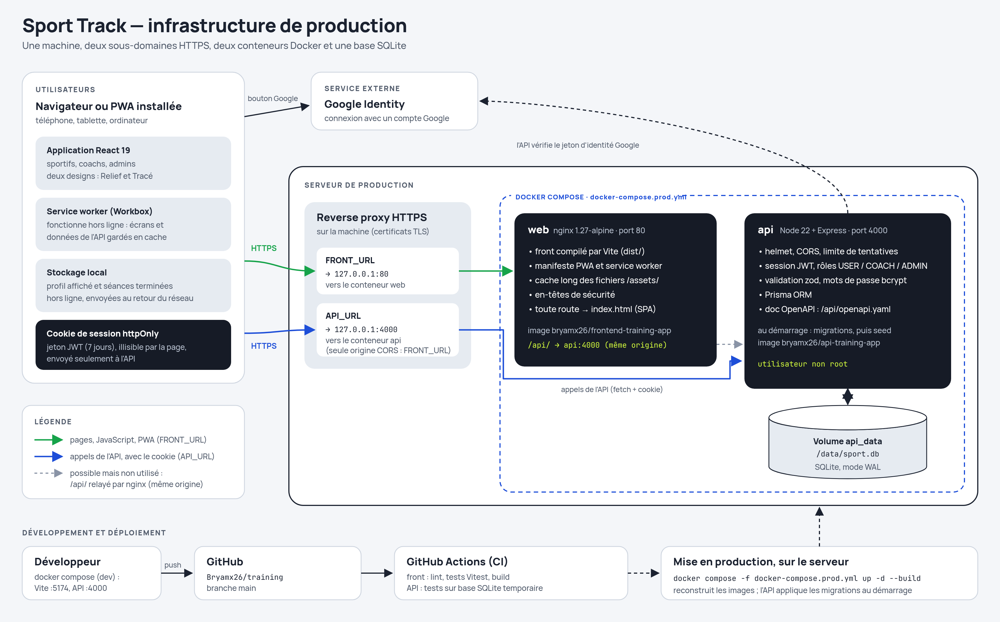

# Sport Track

Application web de suivi sportif entre **coachs** et **sportifs** : le coach crée des séances (ou des templates réutilisables), les attribue à ses abonnés et les note exercice par exercice ; le sportif lance la séance avec un minuteur, saisit ce qu'il a réellement fait et suit sa progression.

- **Front** : React 19, Vite, Tailwind 4, recharts, PWA installable (hors ligne).
- **API** : Node / Express, Prisma, SQLite.
- **Deux designs** au choix dans le profil : *Relief* (néomorphique) et *Tracé* (éditorial), chacun en clair et sombre.

## Infrastructure



En production, un reverse proxy HTTPS sur le serveur publie deux sous-domaines : `FRONT_URL` vers le conteneur **web** (nginx, front compilé et PWA) et `API_URL` vers le conteneur **api** (Node/Express, Prisma), qui stocke ses données dans une base SQLite sur le volume `api_data`. Source modifiable du schéma : [`docs/infrastructure.svg`](docs/infrastructure.svg).

## Démarrage rapide (Docker)

```bash
cp .env.example .env   # puis renseigner JWT_SECRET (commande de génération dans le fichier)
docker compose up --build
```

- Front : <http://localhost:5174>
- API : <http://localhost:4000/api> — documentation OpenAPI : <http://localhost:4000/api/openapi.yaml>

Au démarrage, l'API applique les migrations et le *seed* (muscles, comptes de test et une séance de démo) :

| Rôle | E-mail | Mot de passe |
|---|---|---|
| Admin (coach) | `coach@test.com` | `coach123` |
| Sportif | `lea@test.com` | `lea123` |

## Démarrage sans Docker

Node.js **22** ou plus.

```bash
# API
cd api
npm install
# database/.env doit contenir : DATABASE_URL="file:./sport.db"
npm run db:migrate && npm run db:seed
JWT_SECRET=un-secret-de-dev npm run dev     # http://localhost:4000

# Front (autre terminal, à la racine)
npm install
npm run dev                                 # http://localhost:5173, /api relayé vers :4000
```

## Rôles

| Rôle | Peut… |
|---|---|
| `USER` (sportif) | voir ses séances, les lancer, saisir ses séries, suivre ses stats, s'abonner à des coachs |
| `COACH` | créer / noter ses séances, gérer ses abonnés et ses templates, voir leurs stats |
| `ADMIN` | tout ce que fait un coach, voir tous les comptes, attribuer les rôles, **valider les demandes de compte coach** |

Une inscription publique « coach » crée un compte sportif avec une demande en attente : un admin la valide depuis *Profil › Gérer les utilisateurs*.

## Fonctionnalités

- **Séances** : exercices (catalogue ou nom libre, muscles travaillés), réordonnables, lest, consignes ; création depuis un template ; **répétition hebdomadaire** (N séances d'un coup) ; vue **liste** ou **semaine**.
- **Lecteur de séance** : rotation des exercices, minuteur avec **bips et vibrations**, écran maintenu allumé, **saisie des reps et charges** de chaque série (la note de la séance reste réservée au coach).
- **Notation** par le coach, indépendante pour chaque participant.
- **Statistiques** : courbe des notes, **volume par groupe musculaire** sur la semaine, **records et progression réelle** par exercice.
- **Notifications** dans l'application : nouvelle séance, séance notée, séance terminée, nouvel abonné, demande de compte coach.
- **Hors ligne** : l'application s'installe (PWA) ; une séance déjà ouverte reste consultable et lançable sans réseau, et sa saisie est envoyée au retour de la connexion.

## Sécurité

- Session dans un **cookie httpOnly** `SameSite=Lax` (jamais accessible au JavaScript) ; `COOKIE_SECURE=true` en HTTPS.
- **Limitation** des tentatives de connexion et des inscriptions publiques (`AUTH_RATE_LIMIT`).
- **Validation** de tous les corps de requête (zod) : erreurs 400 `VALIDATION_ERROR` explicites.
- En-têtes de sécurité (helmet), CORS fermé par défaut (`CORS_ORIGIN` pour l'ouvrir), connexion Google limitée aux adresses vérifiées.
- Les droits sont vérifiés côté API ; les restrictions du front ne sont qu'un confort d'affichage.

## Tests et qualité

```bash
npm run lint          # oxlint (front + API)
npm test              # tests unitaires du front (Vitest)
cd api && npm test    # tests d'intégration de l'API (node:test, base SQLite temporaire)
```

La CI GitHub (`.github/workflows/ci.yml`) lance le lint, les tests et le build à chaque push.

## Production

```bash
cp .env.example .env   # JWT_SECRET obligatoire ; COOKIE_SECURE=true derrière HTTPS
docker compose -f docker-compose.prod.yml up -d --build
```

nginx sert le front compilé et relaie `/api` vers l'API ; la base SQLite est dans le volume `api_data`. Aucun compte de test n'est créé en production. Le compte admin vient de `ADMIN_EMAIL` / `ADMIN_PASSWORD` dans `.env` : promu s'il existe déjà, créé sinon (voir `.env.example`). Placer un reverse proxy HTTPS (Caddy, Traefik…) devant le port 80.

## Légal (RGPD)

Avant la mise en ligne, **complète `src/config/legal.js`** (éditeur, contact, hébergeur) : ces informations alimentent les pages publiques `/legal/mentions-legales`, `/legal/confidentialite`, `/legal/cgu` et `/legal/cookies`, accessibles depuis la connexion, l'inscription et le Profil.

- L'inscription exige l'acceptation des CGU, datée en base (`cguAccepteesLe`).
- Profil › *Télécharger mes données* (`GET /api/me/export`, JSON) et *Supprimer mon compte*.
- Polices auto-hébergées (`@fontsource`) ; le script Google n'est chargé qu'au clic sur « Continuer avec Google ». Seul le cookie de session est déposé : pas de bandeau cookies nécessaire.

## Structure

```
api/            API Express (routes, controllers, lib, tests)
database/       schéma Prisma, migrations, seed
src/            front React
  pages/        un fichier par écran (chargé à la demande)
  components/   ui/ (communs aux deux designs), relief/ et trace/ (rendus propres à chaque design)
  lib/          logique sans React (scores, lecteur, file hors ligne…) et ses tests
docker/         images et configuration nginx de production
```
